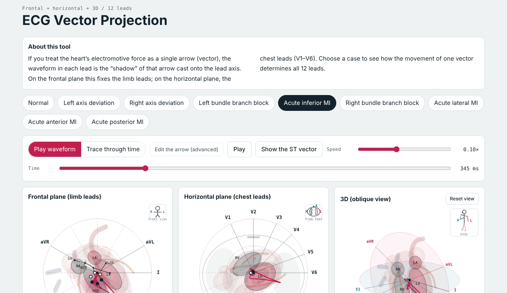

# ECG Vector Projection

[日本語版 (README_JA.md)](README_JA.md) · The page is bilingual: it opens in your browser's language, and the switch at the top right (next to the screen tabs) changes it (`?lang=en` / `?lang=ja` also works).

A single-file teaching tool that shows an ECG as **one heart vector projected onto the lead axes**. Pick a sample case and watch one arrow move in the frontal plane, the horizontal plane and in 3D, while the 12 leads are drawn as its "shadows".

**Why:** many clinicians read an ECG one lead at a time and never see it as a vector. Once the heart is one arrow, a finding such as ST elevation in II, III, aVF with ST depression in aVL stops being a list of leads and becomes a single direction seen from different angles. (That is how the model shows it; in real patients ST depression can have other causes and is judged with the clinical picture.)

## Use it

Open `index.html` in a browser, or serve the folder (GitHub Pages works). No install, no network needed after the fonts load. Static HTML / CSS / JavaScript only.

- **Cases:** normal, left and right axis deviation, left and right bundle branch block, and acute inferior, lateral, anterior and posterior MI. All are idealized samples; no patient ECG is used. In the MI cases a small ST vector points toward the injured wall, and in the model the reciprocal changes appear in the leads that look at it from the other side.
- **Play waveform:** the vector moves through P, QRS and ST-T; the speed slider slows it right down.
- **Trace through time:** drag the tip of the vector along its loop. Only the time changes, so the 12-lead cursor follows the finger.
- **Edit the arrow (advanced):** build a vector that none of the cases has, by direction, size and front-back component, and see all 12 leads recomputed.
- **ST vector shadow:** in the MI cases, the *Show the ST vector* button jumps to the ST segment (the right bundle branch block case has one for its terminal vector), and a card lists which leads show ST elevation and which show the reciprocal depression, computed from the same single arrow (thresholds inside the model, not clinical ST criteria).
- **Quick quiz** (its own *Quiz* screen): (1) given an arrow, mark ↑ / = / ↓ for each limb lead (after checking, choose a lead to see a perpendicular from the arrow tip to its axis); (2) given an ST pattern, choose which of the model's four MI cases produces it. Good for checking whether the staff can think from the vector.
- **Four screens:** *All at once* (it opens first, so nothing is missed), *Vector & controls*, *ECG & notes* and *Quiz*. On a computer you can open the last three in separate windows (for example on two monitors); the windows stay in sync.
- A small figure at the top right of each plane shows the viewing direction (front view for the frontal plane, from the feet for the horizontal plane). In 3D, a small body figure turns with the view. While the tip is returning toward the centre, a small triangle just behind it shows the direction of time.
- On a phone the screens are stacked and each plane is a tab. Tap a lead trace to enlarge it.

**Teaching it?** See the [teaching guide](GUIDE.md): a 30-minute session plan with questions and answers.

## Model and limits

- The vector is `[x, y, z]` (patient's left, down, anterior). Each lead value is the projection of the vector on its axis.
- Frontal axes: I 0°, II 60°, III 120°, aVR −150°, aVL −30°, aVF 90°. Horizontal axes (assumed): V1 115°, V2 90°, V3 65°, V4 45°, V5 20°, V6 0°; chest-lead deflections are multiplied by 1.8 as a stand-in for the proximity effect. Real chest leads are potentials measured at their own electrodes and cannot be derived exactly from six fixed axes, so chest-lead shapes and ST values are model results (for example, the V5–V6 depression in the inferior MI case).
- Waveforms are sums of Gaussian components. The time scale follows ECG paper (40 ms per small square); the vertical scale is arbitrary. The lit parts of the schematic heart show the known activation order, not a real localization.
- **Educational only. Not a measured ECG and not for diagnosis.** The MI cases add only an ST vector to the same QRS and T as the normal case (no pathological Q waves or T-wave changes), and each uses one simple direction, so real extent and combinations (for example inferior plus posterior, or right ventricular involvement) are not shown.

## Related tools

The idea of showing the ECG as a heart vector is not new, and some of these are much more complete than this tool. I found them through web searches and read only their public descriptions; I have not tried them hands-on, so please check them yourself. If you teach ECG, they are worth a look.

- **ECGSIM** (Radboud University Medical Center): an interactive ECG simulator for teaching and research; it can show dipole vector loops and the Frank ECG.
- **[Epicardio Heart Simulator](https://healthysimulation.com/epicardio-heart-simulator)** ([App Store](https://apps.apple.com/app/id1575071257)): a 3D heart simulator with a live 12-lead ECG, action-potential wavefront and a 3D heart-vector view. Paid iPad app.
- **[Opti](https://contra.com/p/glkvvEXQ-opti-3-d-ecg-visualization-education-tool)**: a 3D ECG teaching project that projects a cardiac vector onto the 12 leads and lets you scrub through the cycle.
- **[Sinusly](https://sinusly.pages.dev/)**: an interactive atlas of synthesized ECG strips for teaching.
- **[ECGSim-Advanced](https://f1000research.com/articles/15-714/v1)**: an open-source R Shiny simulator for electrolyte, conduction and repolarization abnormalities.
- **[Real-time vectorcardiography simulator](https://pure.urosario.edu.co/en/publications/real-time-vectorcardiography-simulator-system/)** (Rodriguez et al., 2026): a low-cost hardware and open-source software simulator for vectorcardiography teaching.
- **[ECGpedia: QRS axis](https://en.ecgpedia.org/wiki/Heart_Axis)** and the **[hexaxial reference system](https://en.wikipedia.org/wiki/Hexaxial_reference_system)**: static explanations of the same idea.

What this tool tries to add: one vector that you can drag and trace, shown in the frontal plane, the horizontal plane and 3D at once, with the 12 leads recomputed live, in a single free HTML file that works on a phone, in Japanese and English, built for teaching clinic staff.

## License

[MIT](LICENSE) © 2026 Kariage POMPADOUR Entertainment Corporation. Provided "as is", without warranty. This is a teaching model, not a medical device; do not use it for diagnosis. Fonts are loaded from Google Fonts under their own licenses (SIL Open Font License).
