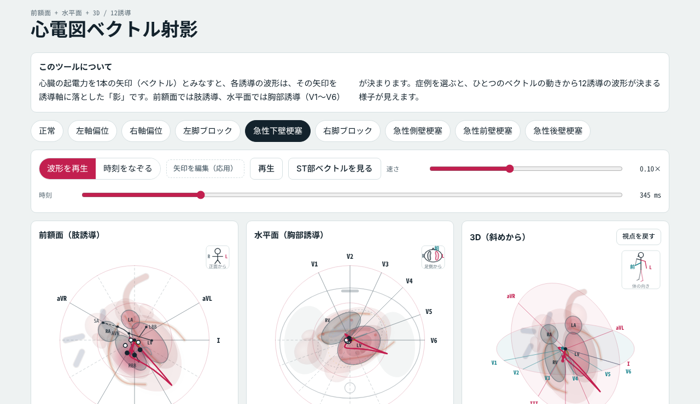

# 心電図ベクトル射影

[English (README.md)](README.md) · ページ本体は日英対応です。ブラウザの言語で開き、右上（画面タブの横）のボタンで切り替えられます（`?lang=ja` / `?lang=en` も使えます）。

心電図を「**1本の心臓ベクトルを、各誘導の軸に射影したもの**」として見せる、1ファイルの教育ツールです。症例を選ぶと、前額面・水平面・3Dで1本の矢印が動き、12誘導の波形がその「影」として描かれます。

**目的：** 心電図を1誘導ずつ読んでしまい、ベクトルとして捉えられない医療者は多くいます。心臓を1本の矢印として見れば、「II・III・aVFのST上昇とaVLのST下降」は、誘導の羅列ではなく、同じ向きを別の角度から見た所見だと分かります（模型での見せ方です。実際のST下降には別の原因もあり、臨床情報と合わせて判断します）。

## 使い方

`index.html` をブラウザで開くだけです（フォルダを配信しても動きます。GitHub Pages 可）。インストール不要で、HTML / CSS / JavaScript だけで動きます。

- **症例：** 正常、左軸偏位、右軸偏位、左脚ブロック、右脚ブロック、急性の下壁・側壁・前壁・後壁梗塞。すべて理想化したサンプルで、患者さんの心電図は使いません。梗塞の症例では、障害された壁に向かう小さなST部ベクトルを加えます。模型では、反対側から見る誘導に対側性変化が出ます。
- **波形を再生：** ベクトルが P → QRS → ST-T と動きます。速さのスライダーで、かなりゆっくりにできます。
- **時刻をなぞる：** ベクトルの軌跡（ループ）に沿って、先端を指でなぞります。動くのは時刻だけなので、12誘導のカーソルも指に合わせて動きます。
- **矢印を編集（応用）：** 症例にない向き・大きさ・前後成分のベクトルを自分で作り、12誘導の波形がどう変わるかを見ます。
- **ST部ベクトルの影：** 梗塞の症例では、「ST部ベクトルを見る」ボタンでST部の時刻に移動できます（右脚ブロックには、終末ベクトル用の同じボタンがあります）。また、ST上昇した誘導と、対側性変化でST下降した誘導を、同じ1本の矢印から計算して一覧にします（模型の中の目安で、臨床のST基準ではありません）。
- **確認クイズ**（専用の「確認クイズ」画面）：(1) 矢印を見て、各肢誘導を ↑ / ＝ / ↓ で答える（答え合わせのあと、誘導を選ぶと、矢印の先から誘導軸への垂線が出ます）。(2) ST変化のパターンに合うものを、模型の4つの梗塞症例から選ぶ。スタッフがベクトルから考えられるかの確認に使えます。
- **4つの画面：** 「まとめて」（最初に開く画面。見落としを防ぎます）「ベクトル・操作」「心電図・解説」「確認クイズ」。パソコンでは、後ろの3つを別ウィンドウで開けます（モニター2台など）。ウィンドウ同士は連動します。
- 各図の右上に、どちらから見ているか（前額面は正面から、水平面は足側から）を示す小さな図があります。3D では、小さな人形が視点と一緒に回ります。先端が中心へ戻っている間だけ、先端のすぐ後ろに、進む向きを示す小さな三角が出ます。
- スマホでは、画面を縦に並べ、面ごとにタブで切り替えます。誘導の波形をタップすると、その誘導が大きく表示されます。

**教えるときは：** [使い方ガイド](GUIDE_JA.md)（質問と答えつきの、約30分の進行案）を見てください。

## モデルと限界

- ベクトルは `[x, y, z]`（患者の左、下、前）です。各誘導の値は、ベクトルをその誘導軸に射影した値です。
- 前額面の軸：I 0°、II 60°、III 120°、aVR −150°、aVL −30°、aVF 90°。水平面の軸（仮定）：V1 115°、V2 90°、V3 65°、V4 45°、V5 20°、V6 0°。近接効果の代わりに、胸部誘導の振れを1.8倍にしています。実際の胸部誘導は、それぞれの電極で測る電位で、6本の固定した軸から正確には導けません。胸部誘導の形やSTの値は、模型の結果です（例：下壁梗塞の V5・V6 の下降）。
- 波形はガウス関数の和です。時間目盛りは心電図用紙に準じ（1目盛り=40 ms）、縦軸は任意の倍率です。心臓の模式図で光る部位は、既知の興奮順序を示す目安で、実際の局在ではありません。
- **教育用です。実測の心電図ではなく、診断には使えません。** 梗塞の症例は、正常例と同じQRSとT波に、ST部ベクトルだけを加えたものです（異常Q波やT波の変化はありません）。向きも単純な1方向なので、実際の広がりや合併（下壁＋後壁、右室梗塞など）は表していません。

## 似たツール

心電図をベクトルで見せる発想は新しいものではなく、このツールより作り込まれたものもあります。ウェブ検索で見つけたもので、公開されている説明を読んだだけです。実際には触っていないので、ご自身で確かめてください。心電図を教える方には、見る価値があります。

- **ECGSIM**（ラドバウド大学医療センター）：教育・研究用の対話型ECGシミュレーター。双極子ベクトルのループやFrank誘導を表示できます。
- **[Epicardio Heart Simulator](https://healthysimulation.com/epicardio-heart-simulator)**（[App Store](https://apps.apple.com/app/id1575071257)）：12誘導心電図、活動電位の波面、3Dの心臓ベクトルを同時に見られる3D心臓シミュレーター。有料のiPadアプリです。
- **[Opti](https://contra.com/p/glkvvEXQ-opti-3-d-ecg-visualization-education-tool)**：3Dの心臓ベクトルを12誘導に射影し、心周期をスクラブできる3D心電図の教育プロジェクト。
- **[Sinusly](https://sinusly.pages.dev/)**：合成した心電図波形を使う、対話型の心電図アトラス。
- **[ECGSim-Advanced](https://f1000research.com/articles/15-714/v1)**：電解質・伝導・再分極の異常を教える、オープンソースのR Shinyシミュレーター。
- **[Real-time vectorcardiography simulator](https://pure.urosario.edu.co/en/publications/real-time-vectorcardiography-simulator-system/)**（Rodriguezら、2026）：ベクトル心電図の教育向けに、低コストのハードウェアとオープンソースのソフトウェアで作られたシミュレーター。
- **[ECGpedia：QRS軸](https://en.ecgpedia.org/wiki/Heart_Axis)** と **[六軸系](https://en.wikipedia.org/wiki/Hexaxial_reference_system)**：同じ考え方の、静的な解説。

このツールが目指した点：動かしてなぞれる1本のベクトルを、前額面・水平面・3Dで同時に見せ、12誘導をその場で計算し直すこと。無料の1つのHTMLで、スマホでも動き、日本語と英語に対応し、クリニックのスタッフ教育に使うことを前提にしています。

## ライセンス

[MIT](LICENSE) © 2026 Kariage POMPADOUR Entertainment Corporation。無保証（AS IS）で提供します。教育用の模型であり、医療機器ではありません。診断には使わないでください。フォントは Google Fonts から読み込み、それぞれのライセンス（SIL Open Font License）に従います。
